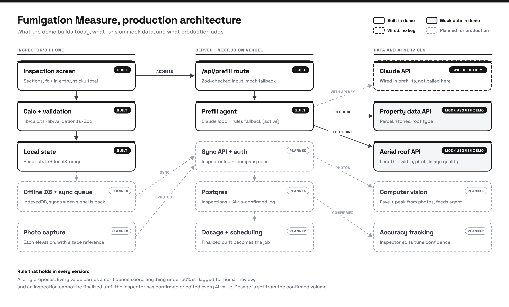
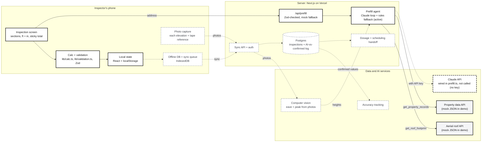

# Fumigation Measure (demo)

> **Demo built for my application to Nextgen Pest Solutions.** It's a presentation piece, not production software, and it isn't affiliated with or endorsed by them.
>
> - **All property and roof data is MOCK.** The two data tools read [`data/mock-property-data.json`](data/mock-property-data.json). Nothing comes from a real county record or imagery provider.
> - **The Claude tool-calling path is wired but isn't used in this deployment.** No Anthropic API key is set, so AI prefill runs a rules-based fallback over the same two mock tools. Every response says which mode ran ("Canned mock agent" in the UI).
> - Inspections are saved in the browser's localStorage only. Customer and inspector names are made up.

Live: https://fumigation-measure.vercel.app

A mobile-first web app for structural fumigation inspectors. The inspector measures each section of a structure (eave height, peak height, length, width), and the app works out average height, cubic volume per section, and total cubic feet. An AI prefill step proposes measurements from property records and a roof footprint, and the inspector confirms or edits every value.



<details open>
<summary>Same diagram in Mermaid (solid = built, grey = mock data, black dashed = wired but no key, grey dashed = planned)</summary>



</details>

### Built, mock, or planned

Matches the diagram: solid boxes are built, grey boxes run on mock data, the black dashed box is wired but unused (no key), and grey dashed boxes are planned.

| Component | Status in this demo | Where |
|---|---|---|
| Inspection screen, sections, ft + in entry, sticky total | **Built** | `app/inspections/[id]/page.tsx`, `components/` |
| Volume calculation | **Built** (Vitest-tested) | `lib/calc.ts` |
| Validation: hard errors, soft warnings, finalize gate | **Built** (Vitest-tested) | `lib/validation.ts` |
| Local state | **Built**, localStorage only | `lib/store.tsx` |
| `/api/prefill` route | **Built** | `app/api/prefill/route.ts` |
| Prefill agent: Claude tool-calling loop | **Built and wired, not active** (no API key, so the rules-based fallback runs) | `lib/agent/prefill.ts` (`runLive`, `runMock`) |
| Claude API | **Wired, not called** in this deployment | `lib/agent/prefill.ts` |
| Property data API (`get_property_records`) | **Mock**: tool is real, data is mock JSON | `lib/agent/property-tools.ts` |
| Aerial roof API (`get_roof_footprint`) | **Mock**: tool is real, data is mock JSON | `lib/agent/property-tools.ts` |
| Offline DB + sync queue, sync API + auth, Postgres | **Planned** | — |
| Photo capture, computer vision for heights | **Planned** | — |
| Accuracy tracking, dosage + scheduling handoff | **Planned** | — |

## What the demo shows

- **Inspection screen.** Address, customer, and any number of sections ("Main house", "Garage", "Pool bath addition"). You can add, duplicate and delete sections. Feet and inches go in separate fields with large touch targets. A sticky bar at the bottom shows the total cubic feet.
- **Calculation** in [`lib/calc.ts`](lib/calc.ts): `avg_height = (eave + peak) / 2`, `section_volume = length × width × avg_height`, `total = Σ sections`.
- **Validation** in [`lib/validation.ts`](lib/validation.ts):
  - *Hard errors* block the section: an empty or zero value, or a peak lower than the eave.
  - *Soft warnings* need a "confirm" tap: an eave under 7 ft or over 30 ft, a peak over 45 ft, a roof rise over 25 ft, a length or width under 4 ft or over 200 ft, or a section more than 6× the next-largest one (usually a typo).
  - Why it matters: fumigant dosage is calculated from cubic volume. Get the volume wrong and the dose is wrong too.
- **AI prefill** in [`lib/agent/prefill.ts`](lib/agent/prefill.ts): the agent calls `get_property_records(address)` and `get_roof_footprint(address)` (both MOCK) and returns one proposal per section, with a confidence for every value. With an API key, Claude drives those tool calls. In this deployment there's no key, so a rules-based fallback calls the same tools and returns proposals in the same shape. Each value shows an "AI suggested · 82% confidence · Confirm" badge. Anything under 60% also gets a **Needs human review** flag. AI never overwrites a value the inspector typed, and the inspection can't be finalized while any AI value is unconfirmed.
- **Summary screen**: a per-section table (stacked cards on a phone), the total, a list of anything still blocking, and **Finalize**.
- **Demo polish**: two sample inspections load on first run (a single-section house in Tampa, and a Sarasota house with a garage and a pool bath addition). There's a "Demo · sample data" badge and a **Reset demo** button.

## Key decisions

| Decision | Why |
|---|---|
| Store lengths as whole **inches** | Integer math until the last division, so dosage numbers never pick up float noise like `30.299999`. |
| Compute `L × W × (eave + peak)` and halve it at the end | Keeps the intermediate value an exact integer even when the average height is a half inch. |
| Formula documented as exact for a **simple gable** | Box to the eave plus a triangular roof prism. For hip roofs it overestimates slightly, which is the safe side for dosage. |
| Two tiers of checks | Hard errors are never right. Soft warnings are sometimes right (a tall church), so the inspector confirms instead of being blocked. |
| AI fills only empty fields; every AI value starts *pending* | The inspector is accountable for the number. AI saves typing but never decides. |
| Claude tool calling with a rules-based fallback | No key, an API error, or a live run slower than 25 seconds all fall back to the same tools plus fixed rules, well inside the route's 60 s limit. The demo can't break live. |
| `localStorage` instead of a database | Enough for a 4-minute demo. The production path is on the diagram. |

## Run it

```bash
npm install
npm run dev          # http://localhost:3000
npm test             # Vitest: calc, validation, mock agent
```

Optional, to run the Claude path locally (the public deployment deliberately doesn't):

```bash
echo "ANTHROPIC_API_KEY=sk-ant-..." > .env.local
```

Without a key the prefill button uses the canned mock agent and labels it that way. Set `PREFILL_MODE=mock` to force mock mode even with a key.

Mock data covers these addresses: 4127 Palmetto Ridge Dr (Tampa), 1880 Coquina Way (Sarasota) and 2214 Banyan Hollow Ct (Orlando). Any other address gets "no data, measure on site".

## Code map

```
lib/calc.ts               pure volume math (inches in, cubic feet out)
lib/validation.ts         Zod hard rules, soft warnings, finalize blockers
lib/types.ts              Zod schemas for Section, Inspection, AI suggestion
lib/store.tsx             React state + localStorage, applyProposal()
lib/agent/prefill.ts      Claude tool-calling loop + mock fallback
lib/agent/property-tools.ts  the two tools (mock JSON today)
data/mock-property-data.json clearly labelled MOCK records and footprints
app/page.tsx              inspection list
app/inspections/[id]/     inspection screen and summary
app/api/prefill/route.ts  server route the button calls
tests/                    Vitest
```

## Roadmap to production

From the diagram, in the order I'd build it:

1. **Offline first.** Move from localStorage to IndexedDB with a sync queue, because inspectors lose signal in attics and rural areas. Add a Postgres schema for inspections, sections and an audit log that records the AI value, the confirmed value and who confirmed it.
2. **Auth and roles.** Inspector, office manager, admin, scoped to a company.
3. **Real data behind the same tools.** Swap the mock bodies of `get_property_records` and `get_roof_footprint` for a property-data provider and an aerial roof-measurement provider. The agent and the UI stay the same.
4. **Computer vision.** The inspector photographs each elevation with a tape or a known reference, and a vision model estimates eave and peak height. This becomes a third agent tool, with its own confidence.
5. **Accuracy loop.** Use the AI-vs-confirmed log to calibrate confidence per source and per roof type, so "82%" means 82%.
6. **Handoff.** Send the finalized volume to dosage calculation and fumigation scheduling in whatever system the office already uses.
7. **More roof shapes.** Hip, mansard and flat-roof formulas, picked per section, each covered by tests.
